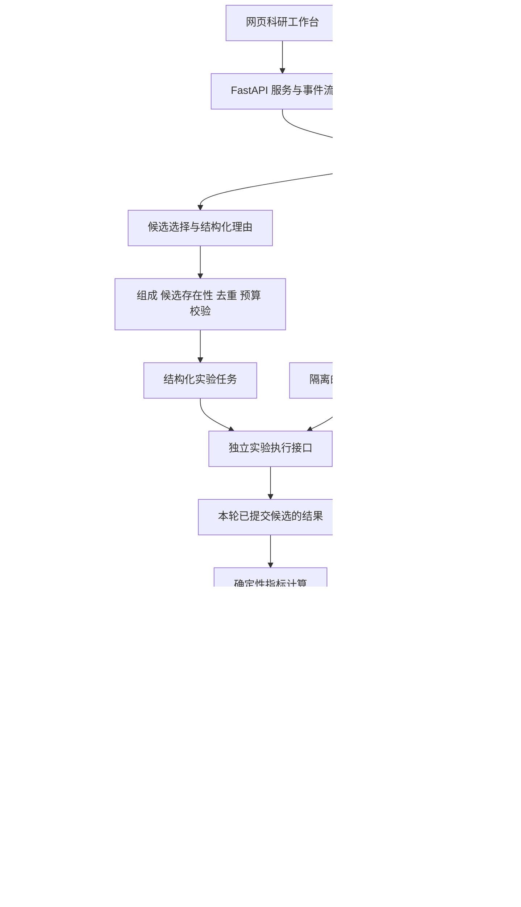

# eCAT 初赛项目规划与实施路线

规划日期：2026 年 10 月 18 日。已纳入用户补充：212 条数据来自实验中的抗反向电流测试；模型由 OpenAINext API 提供，总预算上限 100 美元。当前交付为项目方案，尚未开发 Demo、接入 API 或运行 Agent 对照实验。

## 1 项目结论

建议项目名称：**eCAT 图谱科研记忆驱动的催化材料智能优化系统**。

报告副标题：面向抗反向电流 HER 催化剂研发的文献与实验反馈闭环。

初赛集中证明一件事：在同样的候选池、模型和实验预算下，系统能否利用文献与已经返回的实验结果，更有效地发现低槽电压候选，并解释每一次选择的依据。

核心成果为一个可运行、可追溯、可复现的科研决策闭环，配套一个适合评委理解与演示的网页工作台。自动化实验装备通过明确的任务及回传接口衔接；现阶段使用已有数据进行离线闭环验证。

## 2 已核验的比赛要求

来源：[浙江大学特种装备研究所比赛通知](https://mp.weixin.qq.com/s/ofv8keUQuz1arc40HNbeGg)，发布日期为 2026 年 9 月 8 日，已通过浏览器读取正文。

| 项目 | 通知正文要求 |
| --- | --- |
| 对应赛题 | 题目二十一：基于 AI Agent 的催化材料智能优化系统开发 |
| 初赛交付 | 概念设计方案，即作品报告书，使用附件 2 模板 |
| 提交时间 | 2026 年 11 月 10 日前 |
| 初赛评审 | 2026 年 11 月 13 日选出 10 支队伍进入决赛 |
| 决赛 | 2026 年 11 月 27 日，提交答辩 PPT 和墙报 |
| 团队 | 不超过 3 人，至少包含 1 名浙大 2026 级智慧能源专业本科生 |
| 作品要求 | 原创、符合赛题要求、构思巧妙、设计合理；既有参赛作品的改进须标注创新 |

网页 Demo 是增强方案可信度的辅助成果，通知正文没有将它列为初赛必交项。当前未取得附件 2 正式模板和附件 3 赛题详细说明；微信附件入口提示转入微信，尚未读取附件内容。后续须用正式附件核对章节、格式、题目边界和可能存在的具体要求。以下方案中的优先级是项目建议，不是组委会评分权重。

## 3 文件夹资料与数据核查

已完整读取《比赛任务规划.docx》和《比赛报告框架（仅参考）.docx》的正文及表格，并逐条解析两份 XLSX 的候选组成。

| 资料 | 当前提供的依据 |
| --- | --- |
| 比赛任务规划.docx | 明确单 Agent、文献冷启动、三个记忆子图、隐藏结果接口和对照实验 |
| 比赛报告框架（仅参考）.docx | 给出报告主线、知识库、图谱、节点职责与用语边界 |
| HER实验数据-212条 - 结果已掩盖.xlsx | 212 条候选，仅有 composition 字段 |
| HER实验数据-212条.xlsx | 同一批 212 条候选，字段为 composition 和 voltage |

数据检查结果：

- 两份表候选顺序一致；212 条字符串组成均唯一，按元素及比例排序后的规范化组成也唯一。
- 6 种单元素、155 种二元、51 种三元组成，共涉及 13 种元素。
- 组成比例之和约为 0.999—1.001，存在三位小数舍入误差。建议校验容差为 0.002，保存原值与规范化值，不能直接判为非法组成。
- 完整版有 212 个数值结果，无空缺。全表数值范围约为 2.242—3.259；将其解释为槽电压及 V 单位的依据来自方案文档，仍需补充原始数据说明。
- 表中没有数据出处、制备条件、电解液、温度、电流密度、电极面积、重复测量误差和反向电流耐久性字段。
- 候选中 Au、Ag、Pd 出现较多，Ni 仅出现 1 次。文献收集必须覆盖实际候选元素，不能只收集常见 Ni 基材料后直接套用到整张表。

**用户已说明这批数据来自实验中的抗反向电流测试。** 因而项目可定位为真实抗反向电流测试数据驱动的催化材料筛选。当前表内仍只有一个 voltage 数值，需进一步明确它是反向电流测试前、测试后、恢复阶段还是其他时间点的槽电压，以及各候选是否采用同一测试协议。报告中的抗反极结论强度应与这些定义及原始实验记录相匹配，不能仅凭单一未定义的电压值推导耐久性保持率。

后续若补充反向电流实验，可新增启停循环前后槽电压变化、稳定性保持率、溶出或结构变化等字段，并由领域老师确认测试方案。第一版不把缺失的抗反极指标合成为虚构分数。

## 4 科学问题与可检验创新

研究问题：实验反馈形成的结构化科研记忆，能否改善有限候选池中的序贯筛选效率？

建议围绕三点展开：

1. **证据与决策贯通。** 每个候选建议都关联真实文献片段、适用条件和可定位的来源。
2. **成功与失败共同进入记忆。** 不仅记录实验数值，还记录预期方向、实际变化、支持或否定的假设，以及下一轮应关注的组成区域。
3. **通过受控对照验证记忆作用。** 同模型、同候选池、同预算，比较随机搜索、仅文献 Agent 和完整 Memory Agent。

这些是计划实现并验证的贡献，暂不宣称全球首创或已经获得效率提升。若报告要突出“图谱结构本身”的贡献，增加“文献加普通表格记忆”对照；仅比较有无记忆，只能支持记忆的作用，不能单独证明图谱优于其他记忆形式。

## 5 总体架构

采用单 Agent 的明确工作流。候选选择与诊断使用大模型，数值读取、约束检查、统计和存储使用确定性程序。

关键边界：

- 决策服务只加载掩盖版候选表；完整结果表只挂载到独立执行服务，不放进前端构建产物、提示词、图谱或文献检索目录。
- 执行接口按 run_id、candidate_id 和任务标识返回已提交候选的结果；不能批量返回尚未测试的标签。
- 轮次、最大调用次数和停止条件由程序控制。非法输出返回明确错误并限制修复次数；不得静默用随机候选替代后仍记为 Agent 成功。
- 实验回传及写入使用幂等标识，重试不产生重复实验记录；运行可暂停与恢复。
- 评测服务可读取完整标签计算离线排名，但 Top 10% 阈值和全局最优信息不得反馈到决策服务。运行时停止依照预设轮数，而非隐藏阈值。

## 6 每轮工作流

| 步骤 | 输入与工作 | 可检查的输出 |
| --- | --- | --- |
| 1 文献检索 | 元素组合、目标与适用条件；关键词和语义检索 | 带 evidence_id 和出处的证据集合 |
| 2 记忆检索 | 只查询当前 run 已完成的实验；首轮为空 | 相似组成、不同表现和相关诊断 |
| 3 候选选择 | 证据、未测试候选、预算和历史最佳值 | 候选 ID、理由、预期改善方向、引用 |
| 4 规则校验 | 候选存在性、比例容差、去重和任务条件 | 通过或具体拒绝原因 |
| 5 任务提交 | 合法候选和实验协议引用 | task_id 与状态 |
| 6 结果回传 | 本轮提交的候选 | 原始槽电压、来源、时间和状态 |
| 7 结果诊断 | 与已完成实验比较，程序先计算变化 | 是否改善、与预期是否相符、后续假设 |
| 8 记忆写回 | 事实、证据引用和诊断 | 可追溯的新节点及关系 |

首轮只使用文献与组成，不预置实验标签。从第二轮开始使用历史实验。系统可以将“结构相近但表现不同”的材料一并提供给模型，避免只重复围绕当前最优组成做狭窄搜索。诊断中的机理解释标为假设，不能将一次槽电压变化自动解释为已经证实的因果机制。

候选选择返回字段建议为：run_id、round_id、candidate_id、selected_composition、expected_direction、comparison_experiment_id、evidence_ids、retrieved_experiment_ids、reason、uncertainties。第一轮没有比较实验，方向准确率记为不适用。可保留模型自述 confidence 供分析，但不将其展示为经校准的可靠性概率。

## 7 文献与科研记忆

### 文献处理

先精读并整理 10—20 篇与实际候选和启停背景相关的核心论文，形成可核查的小型证据库；数量是工作计划，不是现有资料规模。当前目录没有论文 PDF。

每段证据记录 paper_id、标题、DOI 或来源链接、section、page、evidence_id、原文、材料组成、条件及适用限制。PDF 无页码时如实标注来源位置，不能补造页码。表格中的组成、条件和结论尽量保持在同一证据单元。

初版使用 Neo4j 全文索引加向量索引做混合检索，通过排名融合后选择少量证据；加入已完成实验的结构检索。先建立人工标注的小问题集，再决定是否增加独立重排服务。PDF 解析先用可用的轻量方案；复杂表格解析不合格时再引入 MinerU，避免初版同时部署多个同功能系统。

### 三个记忆子图

| 子图 | 核心节点 | 核心关系与目的 |
| --- | --- | --- |
| 文献知识 | Paper、Evidence、Material、Element、Condition | 论文包含证据，证据关联材料与条件，材料包含元素及比例 |
| 实验事实 | Experiment、Material、Condition、Result | 实验测试材料、使用条件并产生结果；原始数值由程序写入 |
| 决策轨迹 | Decision、Diagnosis、Suggestion | 决策引用证据和已完成实验，诊断分析结果并影响后续选择 |

组成相似性采用可解释的元素比例向量距离，并结合相同条件过滤，不将化学式字符串的文本相似度作为唯一依据。不同测试条件的结果分组处理。每次读取都带 run_id，确保对照组和独立重复之间不共享已揭示标签。

## 8 技术选择与 API 策略

| 层 | 建议方案 | 选择目的 |
| --- | --- | --- |
| 前端 | React、TypeScript、Vite、CSS 设计变量 | 便于维护状态、图表与演示交互 |
| 后端 | Python、FastAPI、Pydantic | 明确接口与结构化字段验证 |
| 编排 | LangGraph | 节点明确、状态持久化、失败恢复 |
| 科研记忆 | Neo4j，含全文和向量索引 | 文献检索和关系记忆集中管理 |
| 运行记录 | SQLite 与 JSONL 事件日志 | 保存检查点、任务状态和可复现记录 |
| 模型接入 | 后端统一适配层，按实际 API 协议接入 | 模型更换无需修改科研工作流 |
| 图表与图谱 | 轻量图表组件与交互图谱组件 | 具体库在实现前按维护状态核实并锁版本 |
| 部署 | 本地启动优先；需要时用 Docker Compose | 方便比赛演示和跨机器复现 |

LangGraph 官方文档支持在同一图中组合确定性步骤与模型步骤，并通过检查点恢复状态。注意：运行检查点与科研长期记忆职责不同，检查点不能替代三类科研子图。

Neo4j 官方文档支持全文与向量混合检索；不同索引原始分数不可直接比较，应做排名融合。实际开发锁定所安装版本支持的查询语法。

### 模型分工

- 主推理模型：负责候选选择与实验后诊断，优先考察证据引用、结构化输出、约束遵守与响应时间。
- 快速模型：可用于离线文献字段抽取和摘要，结果经过字段及来源检查。
- 嵌入模型：服务证据语义检索，文献入库时离线计算并缓存。
- 复核模型：仅在证据冲突、连续非法输出或需要专门复核时启用；不在每轮强制调用所有顶尖模型。

初期先用一个主模型跑通，再拿固定任务集比较 2—3 个可用模型。记录有效输出率、引用有效率、候选合法率、每轮延迟、Token 与实际费用，依据结果选型。

用户已提供 OpenAINext 的可用模型清单。建议小试候选为 `gpt-6.1-sol`、`claude-sonnet-4-6` 和 `deepseek-v4-pro`，用于本任务的质量与成本实测；此清单不是能力排名，也未完成第三方路由真实性或接口能力测试。第一版以 `gpt-6.1-sol` 作为待测主候选，最终选择以证据引用、结构化输出和费用结果为准。正式记忆对照固定同一个模型，不把模型更换和记忆增益混在一起。

OpenAI 官方文档确认 `gpt-6.1-sol` 支持结构化输出；使用原生工具调用时要求 Responses API。OpenAINext 是否完整转发这些能力尚未确认。为降低依赖，第一版由程序固定编排工具，模型负责返回结构化候选与诊断；如平台只提供基础文本接口，则在返回后用 Pydantic 校验，不能把它描述为原生严格结构化保证。不对不同模型强行使用相同的不兼容参数。

尚需用户提供所用 OpenAINext 的精确文档网址或 Base URL、模型价格表、限流与计费规则。公开搜索出现近似名称服务，清单与用户提供内容不完全一致，当前没有据此认定供应商域名，也不引用其他平台价格作为预算依据。

### 100 美元预算分配

以下是阶段支出上限建议，不是供应商报价，也不是要求一次性花完。

| 用途 | 预算上限 USD | 支出门槛 |
| --- | --- | --- |
| 接口兼容和小样本模型比较 | 5 | 先确认单价、模型 ID 与 Token 统计 |
| 文献抽取与证据整理 | 10 | 优先程序解析；模型只处理需理解的片段 |
| 闭环调试与小规模试验 | 10 | 先完成候选和结果隔离，再调用 |
| 正式对照实验 | 45 | 先用小试估算能否完成计划规模 |
| Demo 实时调用与补录运行 | 10 | 优先复用已保存的真实日志 |
| 预留 | 20 | 应对重试、补充实验和费用偏差 |
| 合计 | 100 | 所有模型调用合并统计 |

按“文献组与 Memory 组各 10 次运行、每次 20 轮、每轮至多两次模型调用”计算，主要对照最多约 800 次调用，随机基线不消耗模型 Token。45 美元正式实验预算要求平均每次调用总成本不高于约 0.056 美元；若小试超出这一门槛，先缩短上下文和输出、选择通过质量门槛的其他候选，或在正式实验开始前调整运行规模。不能在观察结果后选择性删减不利运行。

预算实现包括：按实际输入、输出和推理 Token 及平台规则记账；每次请求预留最坏允许费用；不够覆盖下一次调用时停止；设置输出长度和重试上限；调试期低并发；若平台支持账户或 Key 硬限额则同时配置。平台单价或用量不可确认时暂停批量评测，避免将本地估算冒充最终账单保证。图像、视频和音乐生成不列入第一版支出。

效率措施：文献离线处理；检索结果设定长度上限；只传相关历史；缓存稳定证据与嵌入；模型接口设超时和有限重试；重复点击不重复提交；页面事件流展示明确阶段。延迟目标在接入后实测确定。

API 密钥仅放后端环境变量或本地密钥配置，不进入前端代码、Git 或日志。下一步只需要平台、模型 ID、协议说明和预算，聊天中无需发送密钥。

## 9 网页 Demo 的产品与视觉规划

### 设计定位

新建科研工作台，面向材料、能源装备与工程类评委。桌面和投影优先，首页直接展示科研过程。当前无已有品牌素材，先建立临时视觉规范；以下是拟议设计方向，尚未生成页面或视觉稿。

设计尺度：视觉变化 5/10，动效 3/10，信息密度 7/10，图像依赖 2/10，既有品牌保留需求 1/10。具体落实为稳定的三栏工作区、少量不对称留白、只在阶段切换时使用动效、以真实组成与数据作为画面主体。

视觉温度为克制、清晰、可信。观看距离以笔记本和会议投影为主；主要结论可放大，详细来源在侧栏展开。主工作区最多突出一个当前候选、一条关键证据和一次最新实验结果。

### 推荐视觉系统

- 背景：暖白 #F5F4EF；内容面板 #FFFFFF；主文字 #172326；次级文字 #637174。
- 主强调：深青绿 #176B61；辅助暖金 #B58B4E 仅用于选中轨迹或关键标记。状态异常使用单独定义的可读警示色。
- 字体：中文优先思源黑体或本机可用的清晰中文字体；英文标题采用 Geist Sans 风格；化学组成和数值用等宽字。正式版根据字体许可和可用性本地化。
- 间距：4、8、12、16、24、32、48、64 px；面板圆角 10 px，按钮 6 px。
- 层次：细灰边线为主，悬浮面板使用轻阴影；投影模式加强对比度。
- 动效：按钮反馈约 150 ms，节点状态约 300 ms，使用 ease-out；支持减少动效设置。
- 页面主张通过材料组成、实验轨迹和证据关系表达；数值在实际实验运行后产生。

### 信息结构

| 视图 | 评委要看懂什么 | 主要交互 |
| --- | --- | --- |
| 研究工作台 | 当前目标、候选、决策依据、执行到哪一步 | 运行一轮、暂停、查看历史；中心显示真实闭环 |
| 证据与记忆 | 依据来自哪篇论文，哪些历史实验影响选择 | 点击引用定位原文；按三类子图筛选；只显示相关局部 |
| 效果验证 | Memory 对筛选效率有没有帮助 | 比较方法与运行，查看最佳槽电压曲线和原始日志 |

研究工作台布局：左侧为目标、预算和候选范围；中央为当前候选与阶段进度、结果曲线；右侧为文献和历史实验依据。图谱作为可展开的解释视图，避免初始屏幕铺满不可读关系。

### 约 3 分钟演示脚本

1. 展示 212 个候选与仅含组成的待测列表，说明未测试结果不可见。
2. 点击运行一轮，展示引用文献、选定候选及校验状态。
3. 执行接口返回本轮结果，更新历史最佳值和实验事实节点。
4. 运行下一轮，展开这次使用的历史实验，解释为何改变候选。
5. 切换到已完成的真实评测记录，展示对照曲线和一次失败后调整的轨迹。

演示支持“实时运行”和“已有运行回放”。回放只能使用保存的实际日志，并明确标注为回放；离线标签查询标注为“离线闭环验证”，不能显示为刚刚完成的物理实验。API 不可用时页面可以回放，但实时运行必须显示真实故障状态。

## 10 对照实验与指标

### 基本实验

| 方法 | 文献 | 历史结果 | 目的 |
| --- | --- | --- | --- |
| 随机无放回搜索 | 无 | 不用于决策 | 无策略基线 |
| 仅文献 Agent | 有 | 不向决策节点提供；只用程序排除重复候选 | 文献选择的基线 |
| 文献与图谱 Memory Agent | 有 | 有，且只含当前运行已完成实验 | 观察记忆带来的变化 |
| 文献与普通表格 Memory Agent | 有 | 有，相同历史和检索预算 | 时间允许时检验图谱组织的额外价值 |

建议先做 3 次独立运行、每次 10 轮的小规模试验，定位协议和实现问题；冻结流程后，正式实验计划为每组 10 次运行、每次 20 轮，预算充足再扩展。数量是建议预算，不代表统计充分性保证。

同一批对照保持候选池、主模型、版本、温度、文献库、轮数及合法性规则一致。文献组与 Memory 组使用相同首轮文献选择，再从第二轮比较反馈作用；冷启动质量单独记录。随机组使用明确的随机种子。记录模型返回和时间，外部模型服务不能仅依靠随机种子保证完全复现。

全部方法禁止通过全局排序、目标阈值、未来日志或其他运行图谱获取未揭示结果。由于主规划已经检查过全表统计，后续决策提示词和调参只使用掩盖版、预定协议及当次历史，不能根据全表最佳候选手工设计“必胜路线”。

### 建议主指标

1. 固定预算后获得的最低槽电压，以及历史最佳槽电压曲线。
2. 首次发现全池 Top 10% 候选所需次数和预算内命中率。212 条候选按预定规则取前 22 名；边界同值如何处理需预先冻结。阈值仅评测服务可见。预算内未命中记为截尾或未命中，不应当作“第 20 轮命中”。
3. 每轮时间、Token 和费用，呈现筛选收益与调用成本的关系。

辅助指标：前 22 名候选发现数量、非法候选提案率、重复提案率、实际重复实验数、方向判断准确率、引用定位有效率。禁止重复提交时实际重复实验数应为零，不能将这一规则效果当成模型创新。

方向准确率按模型提交前声明的参考实验和方向，与结果实际变化比较；第一轮排除，浮点相等采用预定数值容差，不引申为实验测量不确定度。引用定位有效不等于结论被原文支持，需要抽样人工核查证据含义与适用条件。

结果展示给出独立运行的均值或中位数及离散程度，保留原始轨迹。10 次运行时不夸大显著性。若完整 Agent 没有改善，检查文献覆盖、检索、候选排序偏差与诊断质量，并如实讨论失败原因。

## 11 初赛报告结构与成果包

正式章节最终映射到附件 2，不直接把参考框架当成组委会模板。

建议正文叙事顺序：

1. 工程问题：波动供电与催化材料研发需求，说明智能优化与实验装备的关系。
2. 项目目标和边界：抗反向电流实验来源、当前输入输出、槽电压的测试阶段与指标解释范围。
3. 总体方案：系统架构、单轮闭环和执行接口。
4. 核心实现：文献证据、三个记忆子图、Agent 与程序的职责。
5. 对照实验：协议、指标、真实曲线及成本。
6. 案例与讨论：成功案例、失败后调整、可追溯依据和局限。
7. 工程可行性与应用路径：实验平台接入、成本构成和阶段性推广。

成果包应包含：

- 按正式模板完成的作品报告书和参考文献。
- 系统架构图、工作流图、图谱结构图。
- 可启动的网页 Demo、后端与模型配置示例。
- 隔离的候选读取及结果接口、数据字典、任务与结果 Schema。
- 文献证据索引、提示词、版本与运行参数。
- 原始实验日志、统计表、绘图脚本和案例链路。
- 启动说明与演示脚本；API 故障时可使用真实运行日志回放。

应用价值先定位于材料课题组或研发平台的候选筛选与实验编排。用实际减少的查询次数和可复核记录说明价值；暂不填入没有来源的市场规模、客户数量或经济收益。

## 12 时间安排

以下以初赛 11 月 10 日前提交为目标，11 月 9 日完成提交版本；每阶段按可检查成果验收。

| 时间 | 工作重点 | 阶段成果 |
| --- | --- | --- |
| 10 月 18—19 日 | 对齐正式附件、实验协议、工况和 API；确定视觉方向 | 冻结范围、字段与评测协议 |
| 10 月 20—23 日 | 数据隔离、规则校验、模型适配、最小工作流 | 能连续完成至少 3 轮，运行记录可恢复 |
| 10 月 24—27 日 | 核心文献、混合检索、三个记忆子图 | 每轮证据与历史实验引用可追溯 |
| 10 月 28—31 日 | 网页工作台、事件流与真实日志回放 | 完整可演示的单轮与多轮闭环 |
| 11 月 1—5 日 | 冻结配置，正式对照，案例分析 | 真实曲线、成本记录与失败案例 |
| 11 月 6—9 日 | 正式报告、插图、复核和提交准备 | 可提交报告与稳定演示包 |

两到三人可按领域文献与报告、Agent 后端与评测、前端交互与演示分工。人员不足时，优先完成三组对照和可追溯闭环；普通表格记忆对照、额外模型复核、复杂 PDF 解析和美术拓展后移。

## 13 需要补齐的信息

优先项：

1. 附件 2 正式作品报告书模板与附件 3 中题目二十一的详细要求。
2. 已知数据来自抗反向电流测试实验；补充 voltage 的测试阶段、工况、单位与原始测试协议，有无前后对照、循环次数及重复测量。
3. 核心论文 PDF 或老师推荐的文献线索；没有时可先检索公开原始研究，逐篇核对。
4. 已知 API 平台为 OpenAINext，模型清单已提供，预算上限 100 美元；补充精确文档链接或 Base URL、价格表、限流和计费规则。

可在开发中确认：实验平台的实际接口、部署电脑、演示联网条件、团队已有代码与现有科研成果。

## 14 查证来源

- [比赛通知](https://mp.weixin.qq.com/s/ofv8keUQuz1arc40HNbeGg)：比赛范围、初赛交付、日期与团队要求。
- [LangGraph overview](https://docs.langchain.com/oss/python/langgraph/overview)：确定性程序与模型节点的组合、编排能力。
- [LangGraph persistence](https://docs.langchain.com/oss/python/langgraph/persistence)：检查点与长期存储的区别，以及本地持久化选择。
- [Neo4j search indexes](https://neo4j.com/docs/cypher-manual/current/indexes/search-indexes/)：全文、向量与混合检索，排名融合要求。
- [GPT-6.1 Sol 模型页](https://developers.openai.com/api/docs/models/gpt-6.1-sol)：官方能力定义；不能据此保证第三方网关实现或价格。
- [Using GPT-6](https://developers.openai.com/api/docs/guides/latest-model)：GPT-6.1 Sol 的工具调用要求使用 Responses API。
- [Structured model outputs](https://developers.openai.com/api/docs/guides/structured-outputs)：严格结构化输出与普通 JSON 结果的区别。
- [Cathodic Protection System against a Reverse-Current after Shut-Down in Zero-Gap Alkaline Water Electrolysis](https://pmc.ncbi.nlm.nih.gov/articles/PMC9709953/)：已检索到的相关原始研究线索；本次全文访问遇到验证页面，后续获取全文并核查后再纳入正式证据库。

上述在线来源核查日期为 2026 年 10 月 18 日。项目方案与数据判断同时依据工作目录内四份原始资料；原文件未修改。
