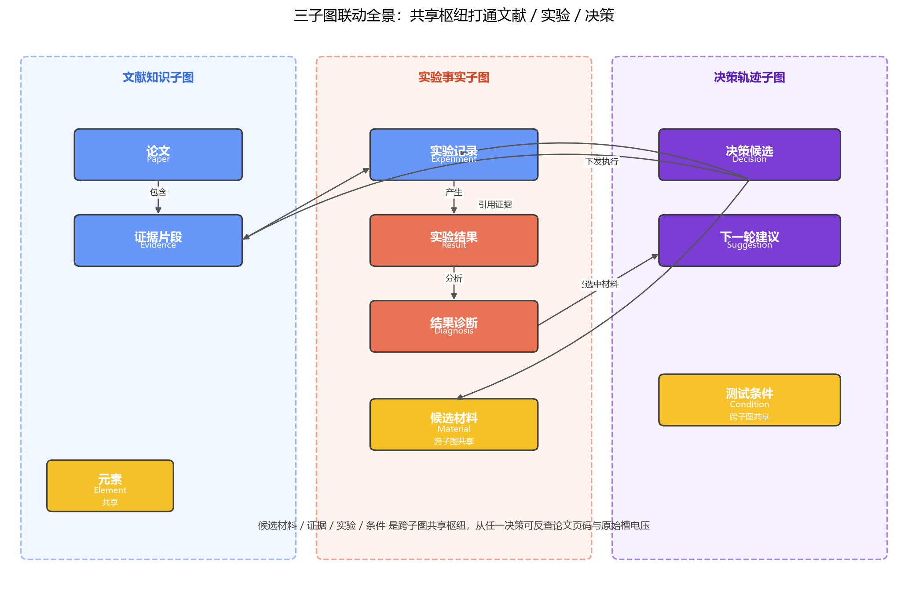
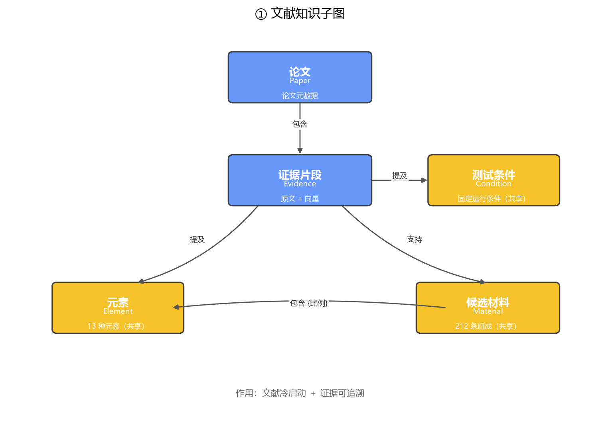
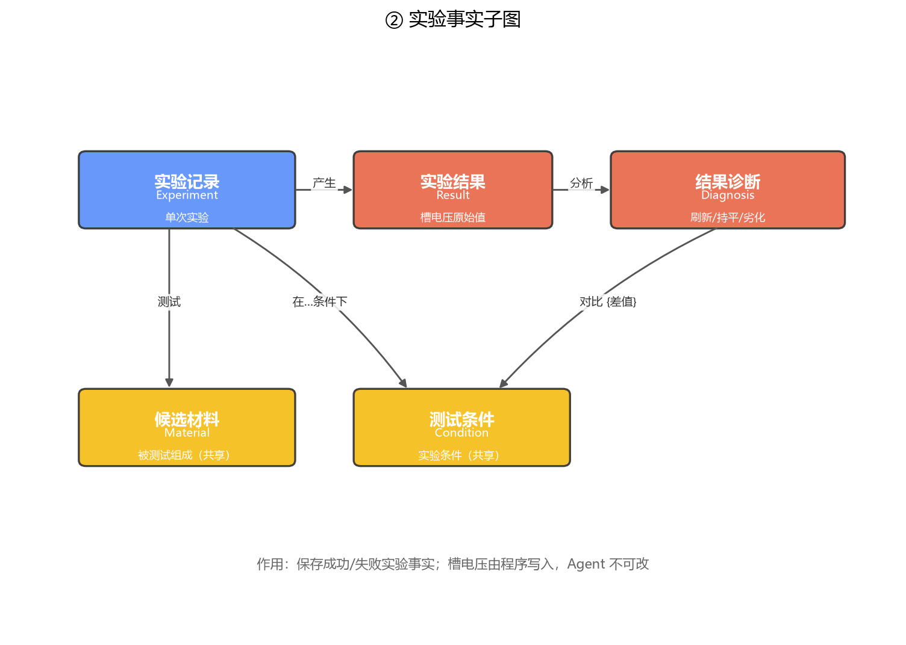
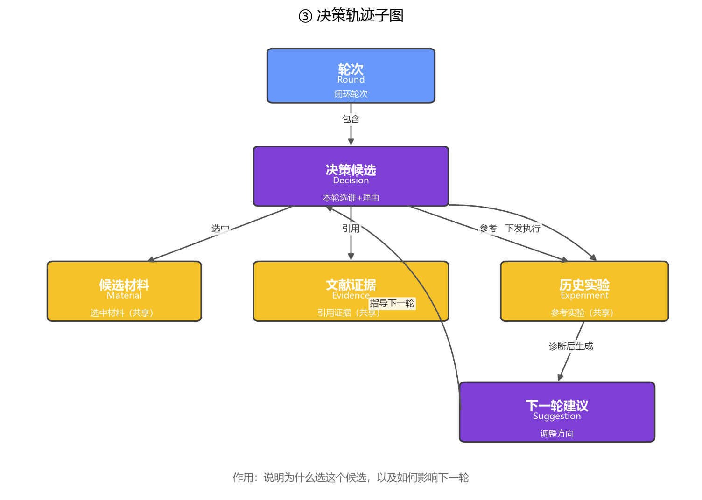

# Neo4j 科研记忆图谱设计说明书

> **项目**：面向抗反向电流 HER 催化剂智能筛选
> **数据基准**：候选池 212 条合金（6 纯金属 + 155 二元 + 51 三元），涉及 13 种元素（Au/Ag/Pd/Zn/Cu/Cd/Ga/In/Tl/Hg/Sn/Rh/Ni）；固定条件下槽电压 `cell_voltage_V` ∈ [2.24, 3.26] V，**越低越好**。

---

## 目录

- [1. 总体架构与设计原则](#1-总体架构与设计原则)
- [2. 三个子图的节点数据字典](#2-三个子图的节点数据字典)
  - [2.1 文献知识子图](#21-文献知识子图)
  - [2.2 实验事实子图](#22-实验事实子图)
  - [2.3 决策轨迹子图](#23-决策轨迹子图)
- [3. 关系数据字典](#3-关系数据字典)
- [4. 跨子图追溯路径](#4-跨子图追溯路径)
- [5. 写回规则](#5-写回规则)
- [6. 索引与约束（Cypher）](#6-索引与约束cypher)
- [7. 典型检索 Cypher](#7-典型检索-cypher)
- [8. 与 LangGraph 节点对接](#8-与-langgraph-节点对接)
- [9. 配套文件清单](#9-配套文件清单)

---

## 1. 总体架构与设计原则

三个子图**逻辑分离、物理同库**——不拆三个 database，通过共享实体节点实现全链路追溯。



> 图 1. 三子图联动全景。蓝框=文献知识子图，红框=实验事实子图，紫框=决策轨迹子图；黄色节点为跨子图共享枢纽（Material / Element / Condition / Evidence）。

**四条铁律**：

1. **原始事实不可篡改** —— 文献证据、实验槽电压由确定性程序写入，Agent 只读。
2. **幂等 MERGE** —— 所有节点用业务主键 `MERGE`，重复执行不产生重复节点。
3. **决策必有依据** —— 每条 `Decision` 至少挂 1 条 `Evidence` 或 1 条历史 `Experiment`。
4. **全链路可追溯** —— 从任意 `Decision` 沿边可反查到论文页码与原始槽电压。

---

## 2. 三个子图的节点数据字典

> 约定：**主键**字段即 Neo4j `MERGE` 时使用的业务键，必须全图唯一；标注「共享」的节点由多个子图共同引用，只建一份。

### 2.1 文献知识子图

| 节点标签 | 主键 | 含义 |
|---|---|---|
| `Paper` | `paper_id` | 一篇论文一条 |
| `Evidence` | `evidence_id` | 一个证据片段一条（原文保留） |
| `Element` ✦共享 | `symbol` | 元素周期表节点，13 种候选元素全量 MERGE |
| `Material` ✦共享 | `composition` | 候选材料节点，与 212 条候选池逐字符一致 |
| `Condition` ✦共享 | `cond_key` | 实验条件节点，文献与实验共用 |

**字段明细**

**`Paper`**
| 字段 | 类型 | 说明 |
|---|---|---|
| `paper_id` | String 🔑 | 主键，如 `P2024_001` |
| `title` | String | 论文标题 |
| `authors` | String[] | 作者列表 |
| `year` | Int | 发表年份 |
| `doi` | String | DOI |
| `journal` | String | 期刊名 |
| `pdf_path` | String | 本地 PDF 路径 |
| `parse_status` | Enum | `parsed` / `cleaned` / `failed` |
| `created_at` | DateTime | 入库时间 |

**`Evidence`**
| 字段 | 类型 | 说明 |
|---|---|---|
| `evidence_id` | String 🔑 | 主键，如 `P2024_001_Sec3_p012_e03` |
| `paper_id` | String | 所属论文 |
| `section` | String | 章节名 |
| `page_num` | Int | 页码 |
| `content` | String | 原文片段 |
| `element_mentions` | String[] | 提及的元素 |
| `material_mentions` | String[] | 提及的材料组成 |
| `condition_mentions` | String[] | 提及的条件 |
| `embedding` | List&lt;Float&gt; | BGE-M3 向量，1024 维 |

**`Element`** ✦共享
| 字段 | 类型 | 说明 |
|---|---|---|
| `symbol` | String 🔑 | 主键，如 `Pd` |
| `atomic_number` | Int | 原子序数 |
| `electronegativity` | Float | 电负性 |
| `her_activity_trend` | String | `high` / `mid` / `low` |
| `anti_reverse_stability` | String | `high` / `mid` / `low` |
| `notes` | String | 备注 |

**`Material`** ✦共享
| 字段 | 类型 | 说明 |
|---|---|---|
| `composition` | String 🔑 | 主键，与候选池完全一致，如 `Ag-0.4-Pd-0.6` |
| `material_id` | String | 内部 ID，如 `MAT_Ag_0_4_Pd_0_6` |
| `n_elements` | Int | 元素个数 |
| `element_list` | String[] | 元素列表，如 `["Ag","Pd"]` |
| `material_type` | String | `pure` / `binary` / `ternary` |
| `in_candidate_pool` | Bool | 是否在 212 条候选池内 |

**`Condition`** ✦共享
| 字段 | 类型 | 说明 |
|---|---|---|
| `cond_key` | String 🔑 | 主键，如 `fixed_running_standard` |
| `condition_type` | String | `electrolyte` / `temperature` / `test_mode` 等 |
| `name` | String | 条件名 |
| `value` | String | 取值 |
| `unit` | String | 单位 |

> 本比赛固定条件：`cond_key = "fixed_running_standard"`，所有 212 条候选均在此条件下测试。



> 图 2. 文献知识子图结构：Paper → Evidence → Material / Element / Condition。

---

### 2.2 实验事实子图

| 节点标签 | 主键 | 含义 |
|---|---|---|
| `Experiment` | `experiment_id` | 一次"提交候选→返回槽电压" |
| `Result` | `result_id` | 槽电压原始数值（Agent 不可改） |
| `Diagnosis` | `diagnosis_id` | 对结果的客观诊断 |

> `Material`、`Condition` 直接复用 §2.1 的共享节点。

**`Experiment`**
| 字段 | 类型 | 说明 |
|---|---|---|
| `experiment_id` | String 🔑 | 主键，如 `EXP_R01_001` |
| `round_num` | Int | 所属轮次 |
| `batch_no` | String | 批次号 |
| `status` | Enum | `submitted` / `running` / `done` / `failed` |
| `submitted_by` | String | Agent 版本号或 baseline 名 |
| `timestamp` | DateTime | 提交时间 |

**`Result`**
| 字段 | 类型 | 说明 |
|---|---|---|
| `result_id` | String 🔑 | 主键，如 `RES_R01_001` |
| `cell_voltage_V` | Float | 槽电压（V），越低越好 |
| `test_status` | Enum | `ok` / `abnormal` / `timeout` |
| `raw_data_path` | String | 原始数据文件路径 |
| `is_best_so_far` | Bool | 是否刷新历史最佳 |
| `created_at` | DateTime | 写入时间 |

**`Diagnosis`**
| 字段 | 类型 | 说明 |
|---|---|---|
| `diagnosis_id` | String 🔑 | 主键，如 `DIA_R01_001` |
| `result_label` | Enum | `best_new` / `improved` / `flat` / `degraded` / `abnormal` |
| `delta_vs_best` | Float | 与历史最佳的差值 |
| `abnormal_cause` | String | 异常原因 |
| `objective_conclusion` | String | 客观结论 |
| `human_reviewed` | Bool | 是否人工复核 |



> 图 3. 实验事实子图结构：Experiment → Material/Condition → Result → Diagnosis。

---

### 2.3 决策轨迹子图

| 节点标签 | 主键 | 含义 |
|---|---|---|
| `Round` | `round_num` | 一轮闭环（候选提交 + 结果回收） |
| `Decision` | `decision_id` | Agent 输出的结构化候选 |
| `Suggestion` | `suggestion_id` | 诊断后给下一轮的调整建议 |

> `Evidence`、`Experiment`、`Material` 全部复用前两个子图的共享节点。

**`Round`**
| 字段 | 类型 | 说明 |
|---|---|---|
| `round_num` | Int 🔑 | 主键，从 1 开始 |
| `started_at` / `finished_at` | DateTime | 起止时间 |
| `agent_version` | String | Agent 版本 |
| `method_tag` | Enum | `random` / `lit_only` / `full_memory`（消融实验用） |

**`Decision`**
| 字段 | 类型 | 说明 |
|---|---|---|
| `decision_id` | String 🔑 | 主键，如 `DEC_R02_001` |
| `round_num` | Int | 所属轮次 |
| `selected_composition` | String | 选中的候选组成（必须命中 212 条池） |
| `expected_direction` | Enum | `lower_voltage` / `stability_check` / `explore_unknown` |
| `confidence` | Float | 0~1 |
| `selection_reason` | String | 选择理由（≤500字，必须引用 evidence_id） |
| `agent_version` | String | Agent 版本 |
| `output_schema_version` | String | 输出 schema 版本 |

**`Suggestion`**
| 字段 | 类型 | 说明 |
|---|---|---|
| `suggestion_id` | String 🔑 | 主键，如 `SUG_R02_001` |
| `adjustment_type` | String | `increase_element` / `decrease_element` / `switch_pair` / `avoid_pair` / `explore_new` |
| `target_element` | String | 调整目标元素 |
| `specific_strategy` | String | 具体策略 |
| `expected_effect` | String | 预期效果 |
| `based_on_diagnosis_id` | String | 基于哪条诊断 |



> 图 4. 决策轨迹子图结构：Round → Decision → Evidence/Experiment/Material；Diagnosis → Suggestion → 下一轮 Decision。

---

## 3. 关系数据字典

> 关系名用 `:` 前缀，属性写在大括号里。

### 3.1 文献知识子图内部

| 关系 | 起点 → 终点 | 属性 | 含义 |
|---|---|---|---|
| `:CONTAINS` | Paper → Evidence | `evidence_order: Int` | 论文包含某证据片段 |
| `:SUPPORTS` | Evidence → Material | `confidence: Float`, `aspect: String` | 证据支持某材料的某方面结论 |
| `:MENTIONS` | Evidence → Element | `context: String` | 证据提及某元素 |
| `:CONTAINS` | Material → Element | `ratio: Float` | 材料含某元素，摩尔占比 |
| `:CO_OCCURS_IN_LIT` | Element → Element | `co_count: Int` | 文献中常共现的元素对 |

### 3.2 实验事实子图内部

| 关系 | 起点 → 终点 | 属性 | 含义 |
|---|---|---|---|
| `:TESTS` | Experiment → Material | — | 本轮测试该候选 |
| `:UNDER` | Experiment → Condition | — | 测试条件 |
| `:PRODUCES` | Experiment → Result | — | 实验产出该结果 |
| `:DIAGNOSED_BY` | Result → Diagnosis | — | 结果被该诊断分析 |
| `:COMPARED_TO` | Diagnosis → Result | `delta: Float` | 与历史最佳对比 |

### 3.3 决策轨迹子图内部

| 关系 | 起点 → 终点 | 属性 | 含义 |
|---|---|---|---|
| `:HAS_DECISION` | Round → Decision | — | 一轮包含一次决策 |
| `:SELECTS` | Decision → Material | — | 决策选中该材料 |
| `:EXECUTED_AS` | Decision → Experiment | — | 决策被下发为某次实验 |
| `:REFERENCES_EVIDENCE` | Decision → Evidence | `ref_weight: Float` | 决策引用的文献证据 |
| `:REFERENCES_EXPERIMENT` | Decision → Experiment | `similarity_score: Float` | 决策参考的历史实验 |
| `:GENERATES` | Diagnosis → Suggestion | — | 诊断产出建议 |
| `:GUIDES` | Suggestion → Decision | — | 建议指导下一轮决策 |
| `:FOLLOWS` | Round → Round | — | 轮次先后 |

---

## 4. 跨子图追溯路径

从一轮决策出发的完整证据链：

```
Round(3)
  └─HAS_DECISION→ Decision("Ag-0.45-Pd-0.55")
       ├─REFERENCES_EVIDENCE→ Evidence(P2024_007_Sec4_p021_e02)
       │                         └─CONTAINS─ Paper(P2024_007)
       ├─REFERENCES_EXPERIMENT→ Experiment(EXP_R02_004)
       │                         └─PRODUCES→ Result(2.347 V)
       ├─SELECTS→ Material(Ag-0.45-Pd-0.55)
       │             └─CONTAINS→ Element(Ag) + Element(Pd)
       └─EXECUTED_AS→ Experiment(EXP_R03_001)
                         └─PRODUCES→ Result(2.31 V, is_best_so_far=true)
                                       └─DIAGNOSED_BY→ Diagnosis(best_new)
                                                          └─GENERATES→ Suggestion(继续微调 Ag/Pd)
                                                                         └─GUIDES→ Decision(Round 4)
```

---

## 5. 写回规则

### 5.1 写入主体与权限

| 数据 | 写入方 | Agent 权限 |
|---|---|---|
| Paper / Evidence / Element / Material / Condition | 文献解析流水线 + 候选池导入脚本 | 只读 |
| Result（槽电压） | 实验结果接口（确定性程序） | **只读，禁止改数值** |
| Experiment / Diagnosis / Decision / Suggestion / Round | Agent 闭环中的写回模块 | 可写，但须过校验 |

### 5.2 分阶段写回时序

| 时机 | 写入节点与关系 | 幂等键 |
|---|---|---|
| **系统初始化（一次性）** | Paper / Evidence / Element / Material / Condition + Material-:CONTAINS→Element | 各节点主键 |
| **Round 1 冷启动** | Round(1)、Decision、Decision-:REFERENCES_EVIDENCE→Evidence | `DEC_R01_001` |
| **任务下发后** | Experiment(submitted)、Decision-:EXECUTED_AS→Experiment、Experiment-:TESTS→Material | `EXP_R{round}_001` |
| **结果返回后** | Result、Experiment(status=done)、Experiment-:PRODUCES→Result | `RES_R{round}_001` |
| **诊断完成后** | Diagnosis、Suggestion、Suggestion-:GUIDES→Decision(下一轮) | `DIA_*` / `SUG_*` |
| **R≥2 每轮** | 同上，并通过 `:REFERENCES_EXPERIMENT` 回连历史 | 同上 |

### 5.3 写回前硬校验（任一失败即回滚）

1. `selected_composition` 必须在 212 条候选池内；
2. 每条 Decision 至少有 1 条 Evidence 或历史 Experiment 引用；
3. **R=1 时不允许引用历史实验**（冷启动只能靠文献）；
4. Agent 输出里若包含 `cell_voltage_V` 字段，直接拒绝（防止伪造结果）。

### 5.4 Agent 结构化输出 Schema

```python
@dataclass
class AgentDecision:
    round_num: int
    selected_composition: str              # 必须命中 Material.composition
    expected_direction: Literal["lower_voltage", "stability_check", "explore_unknown"]
    confidence: float                      # 0~1
    selection_reason: str                  # 必须显式提到 evidence_id
    evidence_ids: list[str]                # 引用的 Evidence.evidence_id
    referenced_experiment_ids: list[str]   # R≥2 非空
    agent_version: str
```

---

## 6. 索引与约束（Cypher）

对应文件 `cypher/00_constraints.cypher`，在 Neo4j Browser 一次执行：

```cypher
// 主键唯一约束（自动建唯一索引）
CREATE CONSTRAINT paper_id_key        FOR (p:Paper)      REQUIRE p.paper_id     IS UNIQUE;
CREATE CONSTRAINT evidence_id_key     FOR (e:Evidence)   REQUIRE e.evidence_id   IS UNIQUE;
CREATE CONSTRAINT element_symbol_key  FOR (el:Element)   REQUIRE el.symbol       IS UNIQUE;
CREATE CONSTRAINT material_comp_key   FOR (m:Material)   REQUIRE m.composition   IS UNIQUE;
CREATE CONSTRAINT cond_key_key        FOR (c:Condition)  REQUIRE c.cond_key      IS UNIQUE;
CREATE CONSTRAINT experiment_id_key  FOR (x:Experiment) REQUIRE x.experiment_id IS UNIQUE;
CREATE CONSTRAINT result_id_key       FOR (r:Result)    REQUIRE r.result_id      IS UNIQUE;
CREATE CONSTRAINT diagnosis_id_key    FOR (d:Diagnosis)  REQUIRE d.diagnosis_id  IS UNIQUE;
CREATE CONSTRAINT decision_id_key     FOR (d:Decision)  REQUIRE d.decision_id    IS UNIQUE;
CREATE CONSTRAINT suggestion_id_key   FOR (s:Suggestion) REQUIRE s.suggestion_id  IS UNIQUE;
CREATE CONSTRAINT round_num_key       FOR (rd:Round)    REQUIRE rd.round_num      IS UNIQUE;

// 普通检索索引
CREATE INDEX result_voltage_idx      FOR (r:Result)   ON (r.cell_voltage_V);
CREATE INDEX exp_round_idx            FOR (x:Experiment) ON (x.round_num);

// 文献证据向量索引（BGE-M3，1024 维）
CREATE VECTOR INDEX evidence_vec_idx FOR (e:Evidence) ON (e.embedding)
  OPTIONS { indexConfig: {
    `vector.dimensions`: 1024,
    `vector.similarity_function`: 'cosine'
  } };
```

---

## 7. 典型检索 Cypher

### 7.1 文献冷启动：向量 + 关键词混合召回

```cypher
CALL db.index.vector.queryNodes('evidence_vec_idx', 20, $query_vec)
YIELD node AS e, score
MATCH (e:Evidence)<-[:CONTAINS]-(p:Paper)
WHERE e.content CONTAINS 'reverse current'
RETURN e.evidence_id, e.content, p.title, p.year, score
ORDER BY score DESC LIMIT 10;
```

### 7.2 相似历史实验：共元素 + 电压接近

```cypher
MATCH (target:Material {composition:$comp})-[:CONTAINS]->(el:Element)
WITH collect(el.symbol) AS target_elems
MATCH (exp:Experiment)-[:TESTS]->(m:Material)-[:CONTAINS]->(el2:Element)
WHERE el2.symbol IN target_elems
WITH exp, m, target_elems, collect(DISTINCT el2.symbol) AS shared
MATCH (exp)-[:PRODUCES]->(r:Result)
RETURN m.composition AS comp, r.cell_voltage_V AS v,
       size(shared)*1.0/size(target_elems) AS overlap, exp.experiment_id
ORDER BY overlap DESC, v ASC LIMIT 10;
```

### 7.3 历史最佳槽电压随轮次变化（出图用）

```cypher
MATCH (rd:Round)<-[:HAS_DECISION]-(:Decision)-[:EXECUTED_AS]->(exp:Experiment)-[:PRODUCES]->(r:Result)
WITH rd.round_num AS round, r.cell_voltage_V AS v
ORDER BY round
RETURN round, v, min(v) OVER (ORDER BY round) AS best_so_far;
```

### 7.4 全链路追溯：某轮决策为什么这么选

```cypher
MATCH (d:Decision {decision_id:$id})
OPTIONAL MATCH (d)-[:REFERENCES_EVIDENCE]->(e:Evidence)<-[:CONTAINS]-(p:Paper)
OPTIONAL MATCH (d)-[:REFERENCES_EXPERIMENT]->(exp:Experiment)-[:PRODUCES]->(r:Result)
OPTIONAL MATCH (d)-[:SELECTS]->(m:Material)
RETURN d.selection_reason AS reason,
       collect(DISTINCT {eid:e.evidence_id, content:e.content, paper:p.title, page:e.page_num}) AS evidence,
       collect(DISTINCT {exp:exp.experiment_id, v:r.cell_voltage_V}) AS history,
       m.composition AS chosen;
```

### 7.5 决策证据可追溯率（评价指标）

```cypher
MATCH (d:Decision)
OPTIONAL MATCH (d)-[:REFERENCES_EVIDENCE|REFERENCES_EXPERIMENT]->(ref)
WITH d, count(ref) > 0 AS has_ref
RETURN count(d) AS total,
       sum(CASE WHEN has_ref THEN 1 ELSE 0 END) AS traced,
       1.0 * sum(CASE WHEN has_ref THEN 1 ELSE 0 END) / count(d) AS trace_rate;
```

---

## 8. 与 LangGraph 节点对接

| LangGraph 节点 | 图谱操作 | 读/写 |
|---|---|---|
| 文献检索 | §7.1 向量+关键词召回 | 读 |
| Memory 检索（相似实验） | §7.2 | 读 |
| 候选设计 | 不直接碰图，LLM 生成 `AgentDecision` | — |
| 规则校验 | 校验 `selected_composition` ∈ 候选池 | 读 |
| 任务生成 | 写 `Round / Decision / Experiment(submitted)` | 写 |
| 结果接收 | 写 `Result`、更新 `Experiment.status=done` | 写（仅程序） |
| 结果诊断 | 写 `Diagnosis / Suggestion`、连 `:GUIDES` | 写（LLM+程序） |
| Memory 写回 | 上述写动作统一事务化提交 | 写 |

---

## 9. 配套文件清单

| 文件 | 作用 |
|---|---|
| `neo4j_memory_schema.md` | 本文档，三图数据字典 + 写回规则 |
| `cypher/00_constraints.cypher` | 主键约束与索引，在 Neo4j Browser 一次执行 |
| `cypher/02_seed_candidates.cypher` | 从 212 条 xlsx 自动生成的候选池 MERGE 脚本 |
| `build_memory_graph.py` | Python 写回模块：候选池初始化 + 单轮闭环写回函数 |
