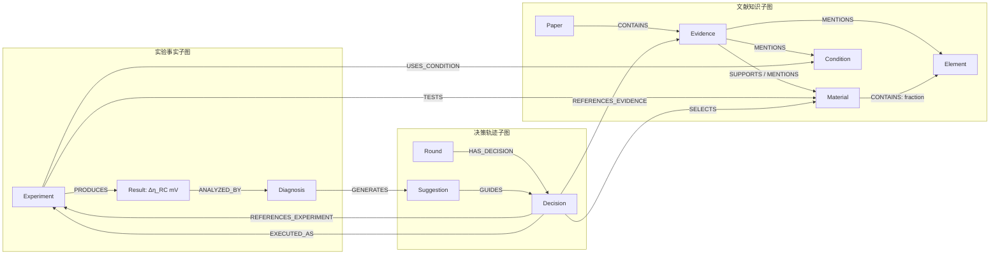

# Neo4j 驱动的科研记忆图谱设计

## 1. 目标与边界
面向抗反向电流 HER 催化剂研发，图谱连接领域文献、历史实验和候选设计。自动化实验平台负责执行结构化实验任务并返回结果；Agent 负责基于证据选择候选、判断改善方向、形成理由并提出后续策略，不训练精确性能预测模型。全图同库分为文献知识、实验事实、决策轨迹三个逻辑子图，以 Material、Element、Condition、Evidence、Experiment 等实体互联追溯。

流程：文献冷启动 → 检索 → 候选设计 → 规则校验 → 任务下发 → 结果返回 → 诊断 → 记忆写回 → 下一轮。首轮不允许引用历史实验；后续轮次可结合文献和历史实验。

## 2. 指标与数据语义
当前基准为 `data/raw/Ni_RC_180_candidate_dataset_v2.xlsx` 的 180 条完整候选数据（掩盖结果表用于候选可见性/盲测边界，测试条件表用于条件元数据）。候选组成、排序及完整数据中的结果均以该文件及其版本为准，不再沿用旧 212 条候选池定义。

`cell_voltage_V` 是整体电池端电压，单位 V；它是旧数据体系中的原始/历史量，不等同于过电位损失。`Δη_RC`（代码属性名建议 `delta_eta_rc`，单位沿用 180 条表的实际单位）表示 RC 相关电化学反应界面损失/贡献的过电位差异指标。两者概念、量纲与物理含义不同，禁止互换、改名伪装或从一个推算另一个。若源表同时有两者，分别存储；若只有 Δη_RC，则 Result 只写 Δη_RC。写入前必须从表头/单位说明读取真实源列与单位并登记 `source_column`、`source_file`、`dataset_version`、转换规则；未确认单位或符号约定时禁止做大小方向判断。性能方向（越大/越小越优）以数据说明/实验定义为准，配置为 `optimization_direction`，不臆定为 cell voltage 的“越低越好”。

数据可见性：Agent 只读允许曝光的 composition、测试条件和已返回历史实验；未提交候选的结果保存在受控结果接口/盲测数据层，规则校验与提交前不得查询。结果返回后由确定性接口写入，模型不得补造数值。

## 3. 节点数据字典
共享节点用统一业务键 MERGE，标签字段按需扩展。

### 文献知识子图
- `Paper`（PK `paper_id`）：`source_file, title, authors, year, doi, journal, parse_status, identity_scheme, created_at`。内部 ID 按来源路径稳定生成；未从 PDF 元数据读取的作者、期刊、DOI、年份留空，不从文件名猜填。
- `Evidence`（PK `evidence_id`）：`page_start, page_end, content, content_sha256, chunk_version, evidence_kind, extraction_status, embedding, created_at`。保留原文与定位，不把模型总结当原始证据。
- `EvidenceAlias`（PK `alias_key`）：`namespace, source_id, source_file, page_num, mapping_status`。把 `P03_p1_011` 或 `L0724` 等源编号解析到内部 Evidence；编号必须带命名空间。
- `Claim`（PK `claim_id`）：`text, effect, elements, review_status, source_quote, created_at`。由文献抽取的结构化表述，必须连到支撑它的 Evidence；未人工审核前状态为 `pending_human_review`，不可作为确定事实。
- `Element`（PK `symbol`）：`name, atomic_number, aliases`。性质/趋势必须有出处，作为带来源的主张而非无证属性。
- `Material`（PK `candidate_id`）：`composition_raw, normalized_composition, element_count, element_list, material_class, dataset_version, in_candidate_pool`。Ni-RC v2 中候选 ID 是稳定业务键；组成字符串保留原样并另存规范形式。
- `Condition`（PK `condition_key`）：`name, value, unit, method, source_type`。

### 实验事实子图
- `Experiment`（PK `experiment_id`）：`round_id, batch_id, status, submitted_at, returned_at, executor, protocol_version, source_run_id`。
- `Result`（PK `result_id`）：`metric_name, metric_value, unit, metric_definition, optimization_direction, test_status, raw_data_uri, source_file, source_sheet, source_row, source_column, dataset_version, returned_at, is_best_so_far`。`metric_name` 取 `delta_eta_rc`、可选 `cell_voltage_V` 等各自独立的量。
- `Diagnosis`（PK `diagnosis_id`）：`outcome_label, delta_vs_previous_best, direction_correct, abnormal_cause, conclusion, diagnosis_method, human_reviewed, created_at`。只有指标、方向和单位一致的结果才可比较。

### 决策轨迹子图
- `Round`（PK `round_id`）：`round_num, started_at, finished_at, agent_version, method_tag, dataset_version`。
- `Decision`（PK `decision_id`）：`selected_composition, expected_direction, confidence, selection_reason, output_schema_version, agent_version, created_at`。
- `Suggestion`（PK `suggestion_id`）：`adjustment_type, target_element, strategy, expected_effect, based_on_diagnosis_id, created_at`。

## 4. 关系字典
- `Paper-[:CONTAINS]->Evidence`
- `EvidenceAlias-[:RESOLVES_TO]->Evidence`
- `Claim-[:GROUNDED_IN]->Evidence`；审核通过后可由 `Claim-[:ABOUT]->Material|Element|Condition` 表达其对象。Evidence 仍只保存原文，不直接承载未经审核的 Claim。
- `Evidence-[:MENTIONS {context}]->Material|Element|Condition`
- `Material-[:CONTAINS {fraction, fraction_basis}]->Element`
- `Experiment-[:TESTS]->Material`；`Experiment-[:USES_CONDITION]->Condition`；`Experiment-[:PRODUCES]->Result`；`Result-[:ANALYZED_BY]->Diagnosis`
- `Round-[:HAS_DECISION]->Decision`；`Decision-[:SELECTS]->Material`；`Decision-[:REFERENCES_EVIDENCE {rank, score}]->Evidence`；`Decision-[:REFERENCES_EXPERIMENT {rank, similarity_basis}]->Experiment`；`Decision-[:EXECUTED_AS]->Experiment`
- `Diagnosis-[:GENERATES]->Suggestion`；`Suggestion-[:GUIDES]->Decision`；`Round-[:FOLLOWS]->Round`

所有跨子图引用保留业务 ID，不把值复制成关系字符串；关系属性记录可解释的权重、比例、来源。

## 5. 写回与权限规则
1. 初始化：确定性导入脚本按数据集版本建立候选 Material、Element、组成关系及 Condition；论文解析流水线建立 Paper、Evidence 和有出处的知识关系。全部用 MERGE，来源标识和版本纳入审计。
2. 检索：Agent 对图谱只读。返回证据必须带 evidence_id、论文、页码/章节；返回历史结果必须带 experiment_id、指标名、数值、单位及条件。
3. 决策暂存：Agent 输出结构化 Decision 草案。校验候选属于当前 180 候选池、组成合法、置信度在 [0,1]、引用 ID 存在且理由引用证据。首轮必须至少有一条文献证据且引用实验列表为空；后续允许证据和已完成历史实验，至少一类依据非空。校验通过后才事务化写入 Round/Decision/关系和提交任务。
4. 任务提交：创建 `Experiment(status='submitted')` 并连到 Material/Condition/Decision。用幂等的外部任务 ID 做键；重试不得生成重复任务。
5. 结果返回：仅可信结果接口写 Result 原值与来源定位，更新 Experiment 状态；Agent 无权覆盖原始事实。异常/缺失结果也记录状态，不伪造指标。
6. 诊断：程序按相同 metric_name、unit、definition、condition 和优化方向比较，计算相对历史最佳的变化；模型可生成解释性 Diagnosis/Suggestion，但将程序计算值与模型文字分字段保存。失败经验不得删除。
7. 事务与审计：每次闭环写回单事务；唯一键冲突按幂等更新非事实元数据，原始结果不可覆盖。更正采用新版本/更正记录，保存 `source_run_id, created_at, created_by, schema_version`。禁止无出处文献事实、跨单位比较、未返回结果进入历史实验检索。

## 6. Agent 输出契约
```json
{
  "round_id": "R002",
  "selected_composition": "候选池原始组成字符串",
  "expected_direction": "improve|not_improve|uncertain",
  "confidence": 0.0,
  "evidence_ids": ["..."],
  "retrieved_experiment_ids": ["..."],
  "reason": "可追溯的选择理由",
  "agent_version": "...",
  "output_schema_version": "1.0"
}
```
不得包含 `metric_value`、`cell_voltage_V` 或 `delta_eta_rc` 的预测值；可输出改善方向判断。候选池命中、首轮规则、ID 存在性、指标计算、实验结果写回均由程序校验。

## 7. Neo4j 约束与查询建议
为 `paper_id, evidence_id, alias_key, claim_id, symbol, candidate_id, condition_key, experiment_id, result_id, diagnosis_id, decision_id, suggestion_id, round_id` 建唯一约束。Result 建 `(metric_name, unit)` 索引，Experiment/Decision 建轮次索引，Evidence 建全文索引；向量索引仅在确认 Neo4j 版本、模型和维度后创建。

关键检索：文献按向量/关键词召回后连回 Paper 定位；历史实验先按元素/比例相似度与条件过滤，再按指定 metric_name 比较；全链路从 Decision 沿 REFERENCES_EVIDENCE/EXPERIMENT、SELECTS、EXECUTED_AS、PRODUCES、ANALYZED_BY 追溯。最佳值序列只在同一指标定义和单位下计算。

## 8. 评价与实施边界
图谱支持规划文件中的筛选效率、最佳指标随实验轮次变化、改善方向判断准确率、Top 10% 发现数、重复率、决策证据可追溯率，以及随机搜索/仅文献/完整 Memory Agent 消融。`cell_voltage_V` 与 `Δη_RC` 不得合并为同一条曲线或同一排序，除非另有明确、可复现的科学换算关系。

旧草稿中基于 212 条数据的表述、固定电压优化方向和字段索引均不直接适用于 180 条数据版本；旧图及 Cypher/构建脚本仍是历史参考，执行前需按本设计同步更新，避免误导性种子数据。

---

## 9. 180 条数据文件字段映射（已核对）

工作簿：`data/raw/Ni_RC_180_candidate_dataset_v2.xlsx`。已直接读取其内部工作表 XML，确认工作表为 `完整数据`、`掩盖结果`、`测试条件`；完整数据表含 180 条候选记录。完整数据首行字段如下：

| Excel 列 | 字段 | 图谱映射 | 暴露规则 |
|---|---|---|---|
| A | 候选ID | `Material.candidate_id` | 可用于候选身份及幂等键 |
| B | Ni组合方案 | `Material.composition_raw` | 原样保留 |
| C | 组合元素 | `Material.element_list` | 解析成元素列表，保留源字段 |
| D:T | Ni、Al、Au、Co、Cr、Cu、Fe、Ir、Mg、Mn、Mo、Pd、Pt、Rh、Ru、W、Zn | `Material.element_fractions` | 每元素分数；只对有数值且定义明确的列建 `CONTAINS` |
| U | 输出指标改为过电位增量Δη_RC (mV) | `Result.metric_name='delta_eta_rc'`, `metric_value`, `unit='mV'` | 结果盲测字段；提交前不得暴露给 Agent |
| V | 全局排名 | `Result.global_rank` 或评估层派生字段 | 评估/分析使用；不能当作实验原始测量值 |
| W | Top 10% | 评估层标签 | 可作为离线评估标签；不得在候选生成时泄露 |

因此，本版指标的规范显示名为 **Δη_RC (mV)**，程序属性名为 `delta_eta_rc`。历史 `cell_voltage_V` 只在原始旧数据或需要兼容的独立测量中作为另一指标保存；它不是该工作簿 U 列的别名。不得以单位换算、字段重命名或语义替换的方式把端电压变为 Δη_RC。

### 9.1 Δη_RC 的推荐字段定义

| 属性 | 定义/约束 |
|---|---|
| `metric_name` | 规范值 `delta_eta_rc` |
| `display_name` | `Δη_RC` 或 `过电位增量 Δ η_RC` |
| `metric_value` | Excel U 列数值，按原精度导入，不舍入覆盖 |
| `unit` | `mV` |
| `metric_definition` | “RC 相关电化学界面损失的过电位增量；定义及实验计算口径以项目数据说明/测试条件表为准” |
| `source_column` | `输出指标改为过电位增量Δη_RC (mV)` |
| `source_sheet` / `source_row` | `完整数据` / 候选对应行号 |
| `dataset_version` | `Ni_RC_180_candidate_dataset_v2` |
| `optimization_direction` | 配置项；只有查看数据定义确认指标方向后才设为 `minimize` 或 `maximize`，不得根据“增量”字样推断 |

`Δη_RC` 的下标 RC 应保留在展示名和文档中；Neo4j 属性使用 ASCII 名称 `delta_eta_rc`，避免 Unicode 字段在查询和客户端间产生兼容问题。图中存机器可用的数值与单位，语义定义另存于 `metric_definition`/指标字典，禁止只存一个无单位数值。

## 10. 节点及关系总览图（逻辑）



图中的跨子图连接是科研记忆的核心：某决策可追溯其所选材料、文献证据、历史实验、返回指标、诊断与后续建议。图谱不把 Agent 的理由当作测量事实；理由属于 Decision，测量事实属于 Result，并通过稳定业务键连接。

## 11. 完整写回时序及事务边界

| 阶段 | 触发者 | 事务写入 | 必须通过的检查 | 回滚/失败处理 |
|---|---|---|---|---|
| 数据集登记 | 管理/导入程序 | DatasetVersion、候选 Material、Element 与比例边、条件字典 | 180 条、候选 ID 唯一；比例语义及单位有说明；结果列访问控制 | 任一主键冲突或行数不符则整批失败 |
| 文献导入 | 文献处理流水线 | Paper、Evidence、CONTAINS、SUPPORTS/MENTIONS | paper/evidence ID 唯一，页码与原文位置有效；抽取主张关联 evidence_id | 有问题片段标记待复核，不把抽取结论升级成事实 |
| 检索上下文 | Agent 工具 | 只读查询，不落写 | 结果只含当前轮允许可见数据；隐藏 U/V/W 不进入候选设计上下文 | 权限过滤失败则拒绝返回并记审计事件 |
| 决策校验 | 确定性规则程序 | 先校验草案，不写正式决策 | 候选 ID/组成命中；证据 ID 存在；R1 无 experiment 引用；R≥2 引用均已完成且有 Result | 退回 Agent 修正，不创建半成品决策节点 |
| 决策及任务提交 | Orchestrator | Round、Decision、SELECTS/引用边、Experiment(submitted)、EXECUTED_AS | 幂等 request_id；任务字段符合执行接口 schema | 单事务提交；执行接口失败则标记提交失败并保留审计 |
| 结果接收 | 实验结果接口 | Result、PRODUCES、Experiment 状态变更 | 返回任务 ID 匹配；候选和条件匹配；指标名/单位/来源列匹配 | 错误结果进隔离队列，不覆盖原记录、不提供给 Agent |
| 诊断与建议 | 指标程序 + Agent | Diagnosis、Suggestion、GENERATES/GUIDES | 仅同指标、单位、定义、条件比较；算术差值由程序产生 | 不能比较时记 `not_comparable`，不生成改善结论 |

正式写入采用事务，节点先 `MERGE` 业务键，再用同一组端点 `MERGE` 关系。不得用 `CREATE` 造成重跑重复数据。事实字段实行追加版本/更正记录策略，不用 Agent 的新输出覆盖旧值。

## 12. 校验规则细化

### 12.1 数据导入

- 读取 `完整数据` 时确认 180 个唯一 `候选ID`；导入清单保存文件散列、文件名、工作表名和导入时间。
- U 列存为数值，单位固定标注 mV；空值与零值区别处理，不以零补缺失。
- V/W 为目标评估结果，严格限制为离线评测域；掩盖结果工作表用于检查盲测流程，不可与 Agent 可见候选特征合并。
- D:T 元素列只有在确认列值表达原子/摩尔/质量分数之后才写入 `fraction_basis`；总和校验容差配置化，不能擅自归一化并丢掉原值。

### 12.2 候选及决策

- 以 `candidate_id` 为候选主身份，以 `composition_raw` 精确保留源表示；规范化 composition 仅用于检索，不覆盖来源表示。
- `expected_direction` 表示 Agent 对下一次实验相对所选比较基准的方向判断，限定 `improve|not_improve|uncertain`；不代表确定的数值预测。
- confidence 必须是有限数且处于 [0,1]；reason 有长度上限并包含可解析引用 ID。
- 重复实验需允许（科研复测），但标记 `replicate_of`/重复原因；评价重复率时另行识别，不能以唯一候选约束拒绝合法复测。

### 12.3 结果和诊断

- Result 原始值、单位、指标定义、候选和条件构成不可变事实。相同实验重复返回时按回调 ID 幂等；冲突值触发人工复核。
- 只有 `metric_name + unit + metric_definition + condition_key + dataset_version` 兼容的记录才能计算 `delta_vs_previous_best`、best-so-far 或改善方向准确率。
- 方向配置未知时保留数值，但 `is_best_so_far` 与诊断标签为未判定；不可默认最小化。
- 排名与 Top 10% 标签由离线评估流程读取，写入隔离评估节点或分析表，不进入 Agent 可读子图。

## 13. 推荐查询模板

### 13.1 决策证据链

```cypher
MATCH (d:Decision {decision_id: $decision_id})
OPTIONAL MATCH (d)-[:SELECTS]->(m:Material)
OPTIONAL MATCH (d)-[:REFERENCES_EVIDENCE]->(e:Evidence)<-[:CONTAINS]-(p:Paper)
OPTIONAL MATCH (d)-[:REFERENCES_EXPERIMENT]->(x:Experiment)-[:PRODUCES]->(r:Result)
RETURN d.selection_reason AS reason, m.candidate_id AS candidate_id,
       collect(DISTINCT {id:e.evidence_id, paper:p.title, page:e.page_num}) AS sources,
       collect(DISTINCT {experiment:x.experiment_id, metric:r.metric_name,
                         value:r.metric_value, unit:r.unit}) AS history;
```

### 13.2 Δη_RC 历史实验（需先应用权限过滤）

```cypher
MATCH (x:Experiment {status:'done'})-[:TESTS]->(m:Material)
MATCH (x)-[:PRODUCES]->(r:Result {metric_name:'delta_eta_rc', unit:'mV'})
WHERE x.dataset_version = $dataset_version
RETURN m.candidate_id AS candidate_id, m.composition_raw AS composition,
       r.metric_value AS delta_eta_rc_mV, x.experiment_id AS experiment_id
ORDER BY r.metric_value;
```

上例排序方向仅演示按数值排序；正式“最佳”查询必须读取配置中的 `optimization_direction`，并确保该查询只返回已完成且已向 Agent 解锁的结果。

## 14. 建议的实施顺序

1. 先固化 v2 数据字典、隐藏列权限和指标优化方向；对 U 列的定义/计算口径从“测试条件”表与项目说明中补齐。
2. 建约束和索引，再导入 Material/Element/Condition；抽样核验 180 个 ID、元素分数、空值及来源追踪。
3. 导入 Paper/Evidence 与可追溯主张；文献事实保留页码和证据片段。
4. 实现只读检索工具和决策校验，再接实验任务提交与结果回调。
5. 加入诊断、建议、下一轮引用；用随机、仅文献、完整 Memory 三组日志验证证据追溯率、筛选效率、方向判断和重复率。

## 15. 引用编号命名空间与来源对账

`P01`、`P03` 这类编号不是论文的永久主键。同一项目不同语料版本/导出脚本可能把编号重新分配，因此图谱以规范化来源路径生成内部 `paper_id`，并用 `EvidenceAlias(namespace, source_id)` 保留外部引用编号。写入决策前，别名必须唯一解析到一个 Evidence；未解析、歧义或命名空间缺失均拒绝写入。

成员 A v5 的 `paper_registry.csv` 与 `her_chunks_v5.csv` 是其 `Pxx_p页码_序号` 的配套映射。已核对的关键映射为：

| 来源命名空间 | 引用 ID | 论文来源文件 | 原文核对 |
|---|---|---|---|
| `member_a_agent_v5` | `P01_p1_003` | `1-s2.0-S0378775322004633-main.pdf` | 停机循环和高温会提高反向电流 |
| `member_a_agent_v5` | `P03_p1_011` | `Adv Funct Materials - 2024 - Jung - Reverse-Current Tolerance...pdf` | Ni 基电极高于 0.6 V vs RHE 时会形成不可逆氢氧化物/氧化物 |
| `member_a_agent_v5` | `P06_p5_040` | `cathodic-protection-system-against-a-reverse-current...pdf` | 循环测试中 Ni 电位升至 1.4 V，Ni/Pb 保持在不可逆相形成阈值以下 |

`ecat/export_demo_v2.py` 和已生成的 `demo_v2/data.js` 使用了另一套固定编号：将 P03 指向 Small Methods 综述、P06 指向 AFM Pb/Ni 论文。它们与成员 A v5 registry 不一致。Member C 导入 v5 alias 时必须按 v5 registry 和该版本 chunk CSV 建立 alias，不能复用演示页对 P 编号的解释。旧引用若不能通过文件、页码和原文片段核实，状态保持未解析，人工复核后再写决策边。

文献处理闭环分为四层：PDF 来源（Paper）→逐字抽取片段（Evidence）→抽取主张（Claim，默认待核）→人工核验后的知识关系。Agent 决策引用 Evidence；只有审核通过的 Claim 才能用于规则或约束。引用的检索分数、排序和 Agent 理由记录在决策/引用边，不回写成文献原文属性。

## 16. 实现文件与执行边界

`build_memory_graph.py --seed-candidates` 只读取 180 候选工作簿的 `掩盖结果` 表，避免候选初始化阶段读取完整数据中的 Δη_RC、排名及 Top 10% 标签。测试条件从项目 v2 manifest 按名称和值入图。`--import-literature` 导入项目已有的原文 chunk 和待核 Claim；`--import-agent-v5-aliases` 使用 v5 registry 将 `Pxx` chunk ID 作为命名空间别名导入。

`write_decision` 只接受已解析的命名空间证据、候选池 ID、首轮/历史实验规则及合法置信度；它创建待提交 Experiment 并关联条件。外部平台派发由 Orchestrator 调用，不由图谱导入脚本暗中触发。`write_experiment_result` 仅供可信回调使用，只接收 mV 的 Δη_RC 源列；事实字段用 `ON CREATE` 追加，重复回调仅在原值、单位和来源行一致时幂等通过，冲突需进入隔离复核。


